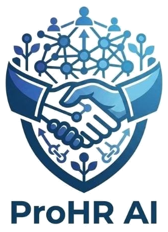

# 🚀 ProHR AI – Decentralized HR & AI Recruitment Platform

<div align="center">
  
  <p><strong>Next-Gen Career & Talent Hub powered by Artificial Intelligence & Blockchain</strong></p>
</div>

---

## 🌟 Overview
**ProHR AI** is a state-of-the-art, decentralized human resources and AI-driven recruitment platform. It streamlines hiring operations, automates candidate resume screening, and bridges talent acquisition with secure credential management.

---

## ✨ Key Features
- **🤖 AI Resume Screening:** Automated analysis and intelligent routing of candidate CVs.
- **🔗 Blockchain Integration:** Secure, verifiable candidate credentials and decentralized records.
- **⚡ Automated Onboarding:** Seamless registration workflow backed by real-time automated welcome notifications (Supabase & Gmail API integration).
- **📊 Unified HR Dashboard:** Comprehensive control panel for tracking applicants, status management, and operations.

---

## 🛠️ Tech Stack
- **Framework:** Next.js (React)
- **Styling:** Tailwind CSS
- **Database & Backend:** Supabase (Webhooks & Realtime triggers)
- **Automation:** Make.com (Supabase to Gmail integration)

---

## 🚀 Getting Started

To run the development server locally:

```bash
npm run dev
# or
yarn dev
# or
pnpm dev
# or
bun dev
🔗 [ pro-hr-ai.vercel.app ]

📄 License

This project is open-source and available under the MIT license.


💼 Project Ownership & Engineering

Reham Hamdy Elsayed Khedr 
